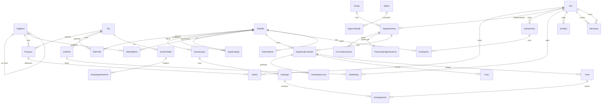

# 02 · Veri Modeli

Teknolojiden bağımsız mantıksal model. Alan adları Türkçe; kodda İngilizce karşılıkları parantezde.

## 1. Varlık ilişki diyagramı

## 2. Varlıklar ve alanlar

### 2.1 Organizasyon

**OrgBirimi (org_unit):** id, üst_birim_id (null = kurum), tür (Kurum | GMY | Direktörlük | Departman | Servis | Bölge | Şube | Portföy ekibi | Ekip…), ad, kod, yönetici_kisi_id, küratör_kisi_id, şube_sınıfı (Şube için: Özel Bankacılık | KOBİ | Ticari | Kurumsal), segment (Portföy ekibi için: Bireysel Satış Temsilcisi | Bireysel Satış | KOBİ Satış | Ticari Satış | Kurumsal Satış | Özel Bankacılık | Müşteri İlişkileri), seviye_derinliği, aktif. Serbest derinlikte ağaç (S19). "Departman" ve "servis" tür etiketidir.
**Rol (role):** id, ad, iş_ailesi, kademe (1..n), yönetici_rolü_mü (bool), ağ (GM | Şube | Bölge), segment (şube rolleri için), açıklama, sonraki_rol_idler (kariyer yolu), aktif.
**FonksiyonelHat (functional_line):** *S26 kararıyla şu an kullanılmıyor* (portföyler bölgeye fonksiyonel bağlı değil); model ileride ihtiyaç olursa diye korunur.
**AlanUzmanı (domain_expert):** segment, yetkinlik_id (ops.), kisi_id (segment GM departmanından), aktif — seviye 5 üst doğrulamasında teknik onaycı.
**İKİşOrtağı (hr_partner):** bölge_org_birim_id, kisi_id, başlangıç, bitiş — bölge kalibrasyonu ve itiraz mercii.
**Pozisyon (position):** id, rol_id, org_birim_id, kadro_kodu, kritik_mi, aktif.
**Kişi (person):** id, sicil_no, ad_soyad, e_posta, işe_giriş_tarihi, doğum/emeklilik_tahmini_tarihi, ayrılma_riski (Düşük/Orta/Yüksek, İK girer), aktif, sistem_rolleri[].
**Atama (assignment):** id, kisi_id, pozisyon_id, başlangıç, bitiş, birincil_mi.

### 2.2 Yetkinlik kütüphanesi

**Yetkinlik (competency):** id, kod, ad, tür (Teknik | Davranışsal), alt_tür (Davranışsal: Çekirdek | Liderlik; Teknik: kategori etiketi), tanım, gelecek_eğilimi (Yükselen | Stabil | Azalan), kritiklik_varsayılan (1–3), durum (Taslak | İncelemede | Aktif | Emekli), sürüm, önceki_sürüm_id, öneren_kisi_id, onaylayan_kisi_id, oluşturma/güncelleme.
**YetkinlikBirim (competency_unit):** yetkinlik_id, org_birim_id, birincil_mi — bir teknik beceri birden çok birime bağlanabilir (ortak havuz).
**SeviyeÇıpası (level_anchor):** yetkinlik_id, seviye (1–5), seviye_adı (ölçeğe göre), genel_çıpa_cümlesi, sürüm.
**Gösterge (indicator):** id, seviye_çıpası_id, sıra, davranış_cümlesi (geçmiş zaman, gözlenebilir), zorunlu_mu, kabul_edilen_kanıt_türleri[], min_kanıt_sayısı (1), kanıt_geçerlilik_ay (24), potansiyel_göstergesi_mi (bool; potansiyel boyutuna da sayılır), potansiyel_boyutu (ops.), otomatik_kanıt_mı (bool), otomatik_kural (KPI_kodu + karşılaştırma + eşik + dönem sayısı | lisans_kodu | yetki_kodu + min_limit | denetim: bulgu_yok), ön_koşul_lisans_kodu (ops.), sürüm.
**KPITanımı (kpi_definition):** kod, ad, birim, yön (yüksek iyi | düşük iyi), segment, kaynak sistemi. **KPIDeğeri (kpi_value):** kisi_id, kpi_kodu, dönem, değer, hedef, içe_aktarma_id.
**Lisans (license):** kisi_id, lisans_kodu (SPK D1/D2/D3, Türev, SEGEM, BES…), alınma, bitiş, durum. **YetkiLimiti (authority_limit):** kisi_id, yetki_kodu, limit, başlangıç, bitiş. Her seviyede 3–5 adet.
**BeceriToplamaTalebi (skill_submission):** id, org_birim_id, öneren_kisi_id, ad, kategori, tanım, kullanılan_işler, seviye_taslakları (1–5), gösterge_taslakları, hedef_seviye_öneri (rol→seviye), kritiklik, seviye3_kişi_tahmini, dış_kıtlık, edinim_ay, gelecek_eğilimi, katalizör_önerisi, başka_birim, benzer_yetkinlik_id (sistem önerisi), durum (Taslak | Gönderildi | İK incelemede | Yönetici teyidi | Müdür onayı | Kütüphaneye alındı | Birleştirildi | Red), İK_notu, birleştirildiği_yetkinlik_id.
**KatalizörBağı (enabler_link):** teknik_yetkinlik_id, davranışsal_yetkinlik_id, ağırlık (0–1, toplam 1), eşik_seviye_hedef (örn. 4), eşik_min_katalizör (örn. 3), hipotez_mi (bool), gözlenen_korelasyon (hesaplanan), sürüm.
**SeviyeTanımı (level_definition):** ölçek (Teknik | Davranışsal), seviye (0–5), ad, genel_tanım — global sözlük.

### 2.3 Rol profili

**RolProfili (role_profile):** rol_id, yetkinlik_id, hedef_seviye (1–5), ağırlık (1–3), zorunlu_mu, sürüm.
**ŞubeSınıfıİstisnası (branch_class_override):** rol_id, şube_sınıfı, yetkinlik_id, hedef_seviye — aynı rol farklı şube sınıfında farklı hedef.
**PozisyonİstisnasI (position_override):** pozisyon_id, yetkinlik_id, hedef_seviye, ağırlık, ekle_mi/çıkar_mı, gerekçe.

### 2.4 Değerlendirme

**Döngü (cycle):** id, ad ("2026 Ana"), tür (Ana | Ara | İşe giriş 90 gün), başlangıç, bitiş, aşama_tarihleri (öz, yönetici, mutabakat, kalibrasyon, kilit), kapsam (departman/servis listesi), kütüphane_sürümü, durum.
**Değerlendirme (assessment):** id, döngü_id, kisi_id, pozisyon_id, yönetici_kisi_id, alan_uzmanı_kisi_id (seviye 5 iddiası varsa; ops.), durum (Açıldı | ÖzBeyanTamam | 360Tamam | YöneticiDoğrulamaTamam | ÜstDoğrulamada | Mutabakatta | İtirazda | PotansiyelTamam | Kesinleşti | Kilitli), mutabakat_tarihi, çalışan_onay, yönetici_onay, genel_not.
**DeğerlendirmeSatırı (assessment_line):** id, değerlendirme_id, yetkinlik_id, yetkinlik_sürüm, hedef_seviye (rol profilinden kopya), öz_beyan_seviyesi (hesaplanan), kanıtlanmış_seviye (hesaplanan), sonraki_seviye_ilerleme_yüzde, mutabık_seviye (≤ kanıtlanmış), açık (hesaplanan), üst_doğrulama_gerekli_mi (seviye 5 iddiası), üst_doğrulayan_id, üst_doğrulama_kararı, itiraz_mı, itiraz_gerekçesi, nihai_karar_İK_id, nihai_karar_üst_yönetici_id, nihai_karar_notu, tutarlılık_bayrağı (katalizör kontrolü), bayat_mı.
**GöstergeDurumu (indicator_status):** satır_id, gösterge_id, öz_işaretledi_mi, otomatik_karar (Kanıtlandı | Kanıtlanmadı | Yok), yönetici_kararı (Kanıtlandı | Kanıtlanmadı | Ek bilgi), alan_uzmanı_kararı (Onay | Red | Yok; seviye 5), gözlem_360_oranı (hesaplanan), karar_notu.
**KalibrasyonOturumu** kademe alanı: Şube | Bölge | Merkez | Departman; bayraklı kayıt listesi (KPI–seviye uyumsuzluğu, cömertlik, alan uzmanı reddi, devralınan seviyeden sapma).
**DevralınanDeğerlendirme (legacy_assessment):** kisi_id, dönem, eski_yetkinlik_kodu, eski_puan (İyi olabilirsin | İyisin | Çok iyisin), eşlenen_yetkinlik_id, dönüştürülmüş_seviye (2 | 3 | 4), kaynak_dosya. **YetkinlikEşleme (competency_mapping):** eski_kod, eski_ad, yeni_yetkinlik_id, eşleme_türü (Birebir | Birleştirme | Emekli), not.
**Kanıt (evidence):** id, kisi_id, tür (İş çıktısı | Proje/görev | Gözlem notu | 360 teyidi | Sertifika/sınav | Paydaş geri bildirimi | Ölçülebilir sonuç | Sistem verisi | Lisans | Yetki limiti | Denetim bulgusu | Vaka sınavı | Gizli müşteri), otomatik_mı (bool; sistem ürettiyse), kaynak_kaydı_id (KPI/lisans/yetki), ne_yaptım, başlangıç_tarihi, bitiş_tarihi, sonuç, doğrulayıcı_kisi_veya_belge, dosya_url, oluşturan_id, durum (Taslak | Sunuldu | Kabul | Ek bilgi | Red), yönetici_kararı_notu, geçerlilik_bitiş (hesaplanan), oluşturma. Kanıt döngüden bağımsız **kanıt kasasında** yaşar; değerlendirmede göstergelere bağlanır.
**GöstergeKanıt (indicator_evidence):** kanıt_id, gösterge_id, satır_id — bir kanıt birden çok göstergeyi karşılayabilir.
**360Davet (feedback_invite):** değerlendirme_id, değerlendirici_kisi_id (anonim hash ile saklanır), ilişki (Ast | Akran | İç müşteri | Üst), seçen (Yönetici | Çalışan), durum, son_tarih.
**360Gözlem (feedback_observation):** davet_id, gösterge_id, yanıt (Gözlemledim | Gözlemlemedim | Fikrim yok), örnek_metin. Davranışsal yetkinliklerde tüm göstergeler; teknikte sadece gözlem teyidi.
**KalibrasyonOturumu (calibration_session):** döngü_id, departman_id, tarih, katılımcılar, kararlar (satır_id → eski/yeni seviye, gerekçe).

### 2.5 Gelişim

**GelişimPlanı (development_plan):** id, kisi_id, döngü_id, durum (Taslak | Onaylı | Devam | Tamamlandı | İptal), onaylayan_id, hedef_rol_id (kariyer hedefi, opsiyonel).
**PlanEylemi (plan_action):** id, plan_id, yetkinlik_id, mevcut_seviye, hedef_seviye, öncelik_puanı (hesaplanan), eylem_tipi (İşBaşında70 | İlişki20 | Eğitim10), eylem_açıklaması, eğitim_id (ops.), mentor_kisi_id (ops.), sorumlu_id, bitiş_tarihi, başarı_kanıtı, durum, ilerleme_yüzde, katalizör_önerisi_mi, kapanış_yeniden_değerlendirme_satır_id.
**Eğitim (learning_item):** id, ad, tür (Sınıf | e-Öğrenme | Sertifika | Gölgeleme | Rotasyon), sağlayıcı, süre, maliyet, aktif.
**EğitimYetkinlik (learning_competency):** eğitim_id, yetkinlik_id, başlangıç_seviye, hedef_seviye.
**Mentorluk (mentoring):** mentor_id, menti_id, yetkinlik_id, başlangıç, bitiş, durum.
**Sertifika (certificate):** kisi_id, ad, veren, alınma, bitiş, yetkinlik_id, dosya_url.

### 2.6 Kritiklik ve yedekleme

**KritikYetkinlik (critical_competency):** yetkinlik_id, dönem, iş_etkisi, iç_kıtlık (hesaplanan), edinim_süresi, dış_kıtlık, kayıp_riski (hesaplanan), toplam_skor, kritik_mi, bilgi_aktarım_planı_id, puanlayan_id.
**KritikRol (critical_role):** rol_id (veya pozisyon_id), dönem, stratejik_etki, benzersizlik, doldurma_süresi, boşluk_maliyeti, kritik_yetkinlik_yoğunluğu (hesaplanan), toplam_skor, kritik_mi, mevcut_sahip_kisi_id, sahip_risk (ayrılma/emeklilik).
**YedekAday (successor):** kritik_rol_id, kisi_id, hazırlık (Hazır | 1-2Yıl | 3+Yıl), hazırlık_önerilen (hesaplanan), potansiyel_puanı, açık_toplamı, teyit_eden_id, not, gelişim_planı_id.
**BilgiAktarımPlanı (knowledge_transfer_plan):** id, yetkinlik_id, sahip_kisi_id, alıcı_kisi_idler, yöntem (Dokümantasyon | Gölgeleme | Çift kadro), bitiş, durum.
**PotansiyelDeğerlendirme (potential_review):** id, değerlendirme_id, kisi_id, dönem, öğrenme_çevikliği, katalizör_profili (hesaplanan), stretch, liderlik_göstergeleri, istek_hareketlilik (öz-beyan), gelişim_hızı (2. döngüden), uzmanlık_potansiyeli (1–5), liderlik_potansiyeli (1–5), güven_düzeyi (Düşük | Orta | Yüksek), yönetici_teyit_id, kalibrasyon_notu, çalışan_kariyer_hedefi_rol_id, hareketliliğe_açık_mı. Performans ve 9-kutu alanları sonraki fazda eklenir.
**PotansiyelGöstergeKanıt:** potansiyel_id, gösterge_id (potansiyel_göstergesi_mi = true), kanıt_id, yönetici_kararı.

### 2.7 İşe alım

**İşeAlımTalebi (hiring_request):** id, rol_id, servis_id, gerekçe (Build/Buy kararı referansı), zorunlu_yetkinlikler (rol profilinden), durum.
**MülakatKılavuzu (interview_guide):** talep_id, yetkinlik_id, hedef_seviye, sorular[], çıpa_referansı.
**AdayDeğerlendirme (candidate_assessment):** talep_id, aday_ad, mülakatçı_id, yetkinlik_id, seviye, gerekçe; sonuç (açık raporu), işe_alındı_mı, kisi_id (alınınca bağlanır; 90. gün karşılaştırması için).

### 2.8 Sistem

**Kullanıcı/Rol/Yetki**, **Bildirim** (şablon, kanal, tetik), **Ayar** (eşikler: kritiklik eşiği, hazırlık kuralları, bayatlama süresi, fark ≥ 2 kuralı), **DenetimGünlüğü** (varlık, id, işlem, önce/sonra JSON, kullanıcı, zaman), **Anlık Görüntü (snapshot)** — her döngü kilitlendiğinde harita metrikleri tablo olarak dondurulur.

## 3. Hesaplama kuralları

| Hesap | Formül |
|---|---|
| Kanıtlanmış seviye | En yüksek N: 1..N her seviyede zorunlu göstergelerin %100'ü ve toplam göstergelerin ≥ %70'i "Kanıtlandı" (geçerli kanıtla) |
| Sonraki seviye ilerleme | `kanıtlanmış gösterge(N+1) / toplam gösterge(N+1)` |
| Mutabık seviye kısıtı | `mutabık_seviye ≤ kanıtlanmış_seviye`; seviye 5 için üst doğrulama kararı = Onay |
| Otomatik kanıt (KPI) | `son N dönemde değer karşılaştırma eşik` sağlanıyorsa gösterge = Kanıtlandı (kanıt kaydı otomatik üretilir) |
| Lisans ön koşulu | Gösterge `ön_koşul_lisans_kodu` için geçerli lisans yoksa gösterge Kanıtlanmadı, seviye kilitlenir |
| KPI–seviye uyumsuzluğu bayrağı | Mutabık seviye ≥ 4 ve ilgili KPI'lar son 2 dönemde hedefin < %80'i |
| Kanıt geçerliliği | `bitiş_tarihi + kanıt_geçerlilik_ay ≥ bugün` |
| 360 gözlem oranı | `Gözlemledim / (Gözlemledim + Gözlemlemedim)`; n < 3 ise gösterilmez |
| Açık | `hedef_seviye − mutabık_seviye` (negatifse "fazlalık") |
| Öncelik puanı | `max(açık,0) × rol_ağırlığı(1–3) × kritiklik(1–3)` |
| Potansiyel (beceri bazlı) | `Σ ağırlık_i × katalizör_seviye_i` (0–5) |
| Uzmanlık potansiyeli | `0,30×öğrenme_çevikliği + 0,30×katalizör_profili + 0,20×stretch + 0,05×liderlik + 0,15×istek` (+ gelişim hızı düzeltmesi) |
| Liderlik potansiyeli | `0,20×öğrenme_çevikliği + 0,10×katalizör_profili + 0,20×stretch + 0,35×liderlik + 0,15×istek` |
| Potansiyel güven düzeyi | Kabul edilmiş potansiyel kanıtı sayısı: <3 Düşük, 3–5 Orta, >5 Yüksek |
| Tutarlılık bayrağı | `teknik_seviye ≥ 4 AND potansiyel_beceri < 2,5` |
| Hedef karşılama | `COUNT(açık ≤ 0) / COUNT(satır)` |
| Bus factor | `COUNT(kişi: mutabık_seviye ≥ 3)` beceri başına |
| İç kıtlık (1–5) | bus factor 0–1→5, 2→4, 3→3, 4–5→2, 6+→1 |
| Kayıp riski (1–5) | seviye ≥ 3 sahiplerinin ayrılma riski ve emeklilik yakınlığından |
| Kritik yetkinlik skoru | `0,30×etki + 0,25×iç_kıtlık + 0,15×edinim + 0,15×dış_kıtlık + 0,15×kayıp_riski` (ayarlanabilir) ≥ 3,5 → kritik |
| Hazırlık (öneri) | Hazır: zorunlu açık = 0 ve Σaçık ≤ 2; 1-2 yıl: zorunlu açık ≤ 1 ve potansiyel ≥ 3; aksi 3+ yıl |
| Gelişim hızı | `Σ(seviye artışı) / kişi / yıl` |
| Yönetici cömertlik endeksi | `ort(yönetici puanı) − ort(departman yönetici puanı)` |
| Katalizör korelasyonu | Pearson(katalizör puanı dönem t, seviye artışı t→t+1); n ≥ 30'da raporlanır |

## 4. Durum makineleri

**Yetkinlik:** Taslak → İncelemede → Aktif → Emekli (Aktif iken değişiklik = yeni sürüm, eski Aktif → Emekli).
**Değerlendirme:** Açıldı → ÖzBeyanTamam → 360Tamam → YöneticiDoğrulamaTamam → (ÜstDoğrulamada: bölge müdürü + alan uzmanı) → Mutabakatta → (İtirazda) → PotansiyelTamam → Kesinleşti → Kilitli.
**Kanıt:** Taslak → Sunuldu → (Kabul | Ek bilgi → Sunuldu | Red) → (Kabul: geçerlilik sonunda Bayat).
**Beceri toplama talebi:** Taslak → Gönderildi → İK incelemede → (Birleştirildi | Red | Yönetici teyidi → Müdür onayı → Kütüphaneye alındı).
**Plan eylemi:** Planlandı → Devam → (Tamamlandı → Yeniden değerlendirme bekliyor → Kapandı) | İptal.
**Döngü:** Hazırlık → Öz aşaması → Yönetici aşaması → Mutabakat → Kalibrasyon → Kilitli → Arşiv.

## 5. Kimlik ve veri kaynakları

- Organizasyon ve kişi verisi: şimdilik CSV/Excel içe aktarma (S1 kararı); HRIS bağlantısı sonraki faz.
- Kimlik doğrulama: SSO tercih; yoksa e-posta + şifre (S17 ile birlikte netleşir).
- Mobil: PWA; kanıt dosyaları mobilden yüklenir, çevrimdışı taslak desteklenir.
- Dosyalar (kanıt, sertifika): nesne depolama; erişim yetki kontrollü.
