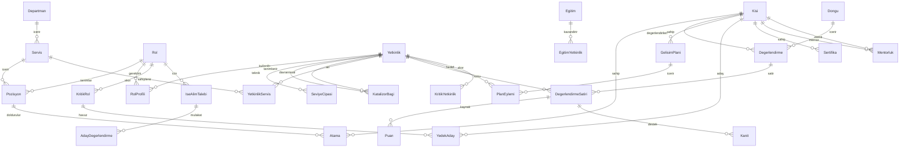

# 02 · Veri Modeli

Teknolojiden bağımsız mantıksal model. Alan adları Türkçe; kodda İngilizce karşılıkları parantezde.

## 1. Varlık ilişki diyagramı

## 2. Varlıklar ve alanlar

### 2.1 Organizasyon

**Departman (department):** id, ad, kod, müdür_kisi_id, aktif.
**Servis (unit):** id, departman_id, ad, kod, yönetici_kisi_id, aktif.
**Rol (role):** id, ad, iş_ailesi, kademe (1..n), yönetici_rolü_mü (bool), açıklama, sonraki_rol_idler (kariyer yolu), aktif.
**Pozisyon (position):** id, rol_id, servis_id, kadro_kodu, kritik_mi, aktif.
**Kişi (person):** id, sicil_no, ad_soyad, e_posta, işe_giriş_tarihi, doğum/emeklilik_tahmini_tarihi, ayrılma_riski (Düşük/Orta/Yüksek, İK girer), aktif, sistem_rolleri[].
**Atama (assignment):** id, kisi_id, pozisyon_id, başlangıç, bitiş, birincil_mi.

### 2.2 Yetkinlik kütüphanesi

**Yetkinlik (competency):** id, kod, ad, tür (Teknik | Davranışsal), alt_tür (Davranışsal: Çekirdek | Liderlik; Teknik: kategori etiketi), tanım, gelecek_eğilimi (Yükselen | Stabil | Azalan), kritiklik_varsayılan (1–3), durum (Taslak | İncelemede | Aktif | Emekli), sürüm, önceki_sürüm_id, öneren_kisi_id, onaylayan_kisi_id, oluşturma/güncelleme.
**YetkinlikServis (competency_unit):** yetkinlik_id, servis_id, birincil_mi — bir teknik beceri birden çok servise bağlanabilir (ortak havuz).
**SeviyeÇıpası (level_anchor):** yetkinlik_id, seviye (1–5), davranış_cümlesi, örnek_kanıt, sürüm.
**KatalizörBağı (enabler_link):** teknik_yetkinlik_id, davranışsal_yetkinlik_id, ağırlık (0–1, toplam 1), eşik_seviye_hedef (örn. 4), eşik_min_katalizör (örn. 3), hipotez_mi (bool), gözlenen_korelasyon (hesaplanan), sürüm.
**SeviyeTanımı (level_definition):** ölçek (Teknik | Davranışsal), seviye (0–5), ad, genel_tanım — global sözlük.

### 2.3 Rol profili

**RolProfili (role_profile):** rol_id, yetkinlik_id, hedef_seviye (1–5), ağırlık (1–3), zorunlu_mu, sürüm.
**PozisyonİstisnasI (position_override):** pozisyon_id, yetkinlik_id, hedef_seviye, ağırlık, ekle_mi/çıkar_mı, gerekçe.

### 2.4 Değerlendirme

**Döngü (cycle):** id, ad ("2026 Ana"), tür (Ana | Ara | İşe giriş 90 gün), başlangıç, bitiş, aşama_tarihleri (öz, yönetici, mutabakat, kalibrasyon, kilit), kapsam (departman/servis listesi), kütüphane_sürümü, durum.
**Değerlendirme (assessment):** id, döngü_id, kisi_id, pozisyon_id, yönetici_kisi_id, durum (Açıldı | ÖzTamam | YöneticiTamam | Mutabakatta | İtirazda | Kesinleşti | Kilitli), mutabakat_tarihi, çalışan_onay, yönetici_onay, genel_not.
**DeğerlendirmeSatırı (assessment_line):** id, değerlendirme_id, yetkinlik_id, yetkinlik_sürüm, hedef_seviye (rol profilinden kopya), mutabık_seviye, açık (hesaplanan), itiraz_mı, itiraz_gerekçesi, nihai_karar_veren_id, nihai_karar_notu, tutarlılık_bayrağı (katalizör kontrolü), doğrulama_gerekli_mi (seviye ≥ 4).
**Puan (score):** satır_id, kaynak (Öz | Yönetici | Akran | Üst | Uzman | Nesnel), veren_kisi_id (akran için anonim hash), seviye (0–5), gerekçe, tarih.
**Kanıt (evidence):** satır_id, tür (Sertifika | Proje | İş örneği | Sınav | Gözlem), açıklama, dosya_url, tarih, doğrulayan_kisi_id.
**KalibrasyonOturumu (calibration_session):** döngü_id, departman_id, tarih, katılımcılar, kararlar (satır_id → eski/yeni seviye, gerekçe).

### 2.5 Gelişim

**GelişimPlanı (development_plan):** id, kisi_id, döngü_id, durum (Taslak | Onaylı | Devam | Tamamlandı | İptal), onaylayan_id, hedef_rol_id (kariyer hedefi, opsiyonel).
**PlanEylemi (plan_action):** id, plan_id, yetkinlik_id, mevcut_seviye, hedef_seviye, öncelik_puanı (hesaplanan), eylem_tipi (İşBaşında70 | İlişki20 | Eğitim10), eylem_açıklaması, eğitim_id (ops.), mentor_kisi_id (ops.), sorumlu_id, bitiş_tarihi, başarı_kanıtı, durum, ilerleme_yüzde, katalizör_önerisi_mi, kapanış_yeniden_değerlendirme_satır_id.
**Eğitim (learning_item):** id, ad, tür (Sınıf | e-Öğrenme | Sertifika | Gölgeleme | Rotasyon), sağlayıcı, süre, maliyet, aktif.
**EğitimYetkinlik (learning_competency):** eğitim_id, yetkinlik_id, başlangıç_seviye, hedef_seviye.
**Mentorluk (mentoring):** mentor_id, menti_id, yetkinlik_id, başlangıç, bitiş, durum.
**Sertifika (certificate):** kisi_id, ad, veren, alınma, bitiş, yetkinlik_id, dosya_url.

### 2.6 Kritiklik ve yedekleme

**KritikYetkinlik (critical_competency):** yetkinlik_id, dönem, iş_etkisi, iç_kıtlık (hesaplanan), edinim_süresi, dış_kıtlık, kayıp_riski (hesaplanan), toplam_skor, kritik_mi, bilgi_aktarım_planı_id, puanlayan_id.
**KritikRol (critical_role):** rol_id (veya pozisyon_id), dönem, stratejik_etki, benzersizlik, doldurma_süresi, boşluk_maliyeti, kritik_yetkinlik_yoğunluğu (hesaplanan), toplam_skor, kritik_mi, mevcut_sahip_kisi_id, sahip_risk (ayrılma/emeklilik).
**YedekAday (successor):** kritik_rol_id, kisi_id, hazırlık (Hazır | 1-2Yıl | 3+Yıl), hazırlık_önerilen (hesaplanan), potansiyel_puanı, açık_toplamı, teyit_eden_id, not, gelişim_planı_id.
**BilgiAktarımPlanı (knowledge_transfer_plan):** id, yetkinlik_id, sahip_kisi_id, alıcı_kisi_idler, yöntem (Dokümantasyon | Gölgeleme | Çift kadro), bitiş, durum.
**PotansiyelDeğerlendirme (potential_review):** kisi_id, dönem, performans_puanı (dış sistem/İK), potansiyel_puanı (hesaplanan+teyit), dokuz_kutu_hücre.

### 2.7 İşe alım

**İşeAlımTalebi (hiring_request):** id, rol_id, servis_id, gerekçe (Build/Buy kararı referansı), zorunlu_yetkinlikler (rol profilinden), durum.
**MülakatKılavuzu (interview_guide):** talep_id, yetkinlik_id, hedef_seviye, sorular[], çıpa_referansı.
**AdayDeğerlendirme (candidate_assessment):** talep_id, aday_ad, mülakatçı_id, yetkinlik_id, seviye, gerekçe; sonuç (açık raporu), işe_alındı_mı, kisi_id (alınınca bağlanır; 90. gün karşılaştırması için).

### 2.8 Sistem

**Kullanıcı/Rol/Yetki**, **Bildirim** (şablon, kanal, tetik), **Ayar** (eşikler: kritiklik eşiği, hazırlık kuralları, bayatlama süresi, fark ≥ 2 kuralı), **DenetimGünlüğü** (varlık, id, işlem, önce/sonra JSON, kullanıcı, zaman), **Anlık Görüntü (snapshot)** — her döngü kilitlendiğinde harita metrikleri tablo olarak dondurulur.

## 3. Hesaplama kuralları

| Hesap | Formül |
|---|---|
| Açık | `hedef_seviye − mutabık_seviye` (negatifse "fazlalık") |
| Öncelik puanı | `max(açık,0) × rol_ağırlığı(1–3) × kritiklik(1–3)` |
| Potansiyel (beceri bazlı) | `Σ ağırlık_i × katalizör_seviye_i` (0–5) |
| Potansiyel (kişi) | `0,6 × ort(katalizör potansiyelleri) + 0,4 × ort(liderlik yetkinlikleri)`; performans varsa 9-kutu |
| Tutarlılık bayrağı | `teknik_seviye ≥ 4 AND potansiyel_beceri < 2,5` |
| Hedef karşılama | `COUNT(açık ≤ 0) / COUNT(satır)` |
| Bus factor | `COUNT(kişi: mutabık_seviye ≥ 3)` beceri başına |
| İç kıtlık (1–5) | bus factor 0–1→5, 2→4, 3→3, 4–5→2, 6+→1 |
| Kayıp riski (1–5) | seviye ≥ 3 sahiplerinin ayrılma riski ve emeklilik yakınlığından |
| Kritik yetkinlik skoru | `0,30×etki + 0,25×iç_kıtlık + 0,15×edinim + 0,15×dış_kıtlık + 0,15×kayıp_riski` (ayarlanabilir) ≥ 3,5 → kritik |
| Hazırlık (öneri) | Hazır: zorunlu açık = 0 ve Σaçık ≤ 2; 1-2 yıl: zorunlu açık ≤ 1 ve potansiyel ≥ 3; aksi 3+ yıl |
| Gelişim hızı | `Σ(seviye artışı) / kişi / yıl` |
| Yönetici cömertlik endeksi | `ort(yönetici puanı) − ort(departman yönetici puanı)` |
| Katalizör korelasyonu | Pearson(katalizör puanı dönem t, seviye artışı t→t+1); n ≥ 30'da raporlanır |

## 4. Durum makineleri

**Yetkinlik:** Taslak → İncelemede → Aktif → Emekli (Aktif iken değişiklik = yeni sürüm, eski Aktif → Emekli).
**Değerlendirme:** Açıldı → ÖzTamam → YöneticiTamam → Mutabakatta → (Kesinleşti | İtirazda → Kesinleşti) → Kilitli.
**Plan eylemi:** Planlandı → Devam → (Tamamlandı → Yeniden değerlendirme bekliyor → Kapandı) | İptal.
**Döngü:** Hazırlık → Öz aşaması → Yönetici aşaması → Mutabakat → Kalibrasyon → Kilitli → Arşiv.

## 5. Kimlik ve veri kaynakları

- Organizasyon ve kişi verisi: HRIS'ten içe aktarma (CSV/Excel veya API) ❓ S1.
- Kimlik doğrulama: SSO (Entra ID / Google) tercih; yoksa e-posta + şifre ❓ S8.
- Dosyalar (kanıt, sertifika): nesne depolama; erişim yetki kontrollü.
