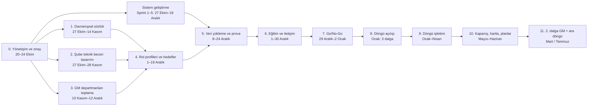

# 08 · Uygulama Akışı — Adım Adım (Ocak 2027 açılışı)

Bugün: 20 Ekim 2026. Hedef: **Ocak 2027'de ilk değerlendirme döngüsünün açılması.** Ocak'a 10 hafta var.

> **Dürüst uyarı:** 10 haftada hem kütüphane (davranışsal + şube teknik + 100+ GM departmanı teknik) hem de sistemin tamamı bitmez. Ocak açılışı gerçekçi olsun diye akış iki ilkeyle kuruldu:
> 1. **Ocak'ta açılan şey döngüdür, sistemin tamamı değil.** Döngüyü açmak için gereken modüller (organizasyon, kütüphane, rol profili, kanıt kasası, değerlendirme) Aralık'ta hazır olur; analitik, gelişim planı, yedekleme ve işe alım modülleri döngü sürerken, ihtiyaç duyulduğu aşamadan önce devreye girer.
> 2. **GM departmanları iki dalgada girer.** Ocak'ta tüm şube ağı + teknik becerisi Aralık ortasına kadar onaylanan GM departmanları açılır; kalan departmanlar Mart dalgasında aynı döngüye katılır. Davranışsal değerlendirme Ocak'ta herkes için açılır (sözlük zaten var).

---

## Akışın bütünü

---

## Adım 0 · Yönetişim ve tasarım onayı — 20–24 Ekim

**Yapılacaklar**
- Tasarım dokümanlarının (01–07) onayı; açık sorularda varsayılanların kabulü (rol kademeleri şimdilik varsayılan).
- Proje sponsoru (İK'dan sorumlu GMY) ve **yönlendirme kurulu**: İK direktörü, Şube Bankacılığı GMY, segment GMY temsilcileri, BT.
- **Çekirdek ekip:** proje lideri (siz), İK yetkinlik ekibi (3–4), 15 bölge İK iş ortağı, BT/geliştirme, iletişim.
- Karar hakları: kütüphane onayı (İK + ilgili müdür), eşik onayı (segment GMY), takvim (yönlendirme kurulu).
- Haftalık 30 dk durum toplantısı; risk kaydı açılır.

**Dikkat**
- Sponsor üst yönetimden olmazsa 100+ departman müdürü beceri toplamaya zaman ayırmaz. Açılış duyurusu Genel Müdür imzalı olmalı.
- "Ücret ve terfiden ayrık" ilkesi yönlendirme kurulunda yazılı karara bağlanmalı; sonradan değişirse güven kaybı yaşanır.

**Çıktı:** onaylı tasarım, RACI, takvim, risk kaydı.

---

## Adım 1 · Davranışsal sözlük ve göstergeler — 27 Ekim–14 Kasım

**Yapılacaklar**
- İK ekibi 04 dokümanındaki adaylardan **8–12 çekirdek + 5–7 liderlik** yetkinliği seçer.
- Mevcut davranışsal listeyi yeni sözlüğe **eşler** (birebir / birleştirme / emekli).
- Her yetkinlik × 5 seviye için **3–5 gösterge** yazılır, zorunlu olanlar ve kabul edilen kanıt türleri işaretlenir.
- 3'lü ölçek dönüşümü (2/3/4) ve iletişim metni hazırlanır.
- 360 soru seti (gösterge bazlı, ≤ 10 dk) hazırlanır.

**Dikkat**
- Göstergeler geçmiş zaman ve gözlenebilir olmalı; "yapabilir" cümlesi kabul edilmez (05 §2 kuralları).
- Her yetkinlik en az bir teknik becerinin katalizörü olmalı; olmayan yetkinliği sorgulayın.
- Mevcut listeden vazgeçilen yetkinlikler için bölgelere "neden" anlatılmalı; alışkanlık direnci burada başlar.
- Liderlik yetkinlikleri 600 yöneticiye uygulanacak; şube müdürü ve GM yöneticisi için aynı göstergeler çalışıyor mu test edin.

**Çıktı:** Davranışsal sözlük v1.0 (göstergeli), eşleme tablosu, 360 formu.
**Çıkış kriteri:** İK direktörü onayı; 5 yöneticiyle gösterge anlaşılırlık testi yapılmış.

---

## Adım 2 · Şube ağı teknik beceri tasarımı — 27 Ekim–28 Kasım

**Yapılacaklar**
- Rol başına çalıştay (BST, Müşteri İlişkileri, Bireysel Satış, KOBİ Satış, Ticari Satış, Kurumsal Satış, Özel Bankacılık, Şube Müdürü, Bölge Müdürü ≈ 9 çalıştay): segment GM departmanı + 2–3 bölge temsilcisi + 2–3 şube müdürü + İK.
- 06 §3'teki beş katmanlı set üzerinden beceri listesi, seviye çıpaları ve **göstergeler**.
- **KPI eşikleri:** her otomatik kanıt göstergesi için segment GMY'si eşik verir ("çapraz satış ≥ hedefin %100'ü, 2 dönem üst üste").
- Lisans ve yetki limiti → gösterge eşlemesi (SPK, SEGEM; kredi yetki kademeleri).
- Şube sınıfına göre hedef istisnaları.
- Katalizör bağları (her teknik beceri için 1–3 davranışsal yetkinlik, ağırlık).
- Seviye 5 için segment başına alan uzmanı adları.

**Dikkat**
- Rol başına beceri sayısı **12–18** ile sınırlı; aşarsa yönetici yükü taşınmaz (06 §6).
- KPI eşikleri çok yüksek konursa kimse 3'ü geçemez, çok düşükse herkes 4 olur; geçen yılın dağılımıyla eşikleri simüle edin.
- Kurumsal Satış ve Özel Bankacılık az kişilik ama kritik; göstergeleri acele yazılmasın.
- Sistem verisi olmayan beceriler (ör. dış ticaret) için vaka sınavı/gözlem kanıtı tanımlanmalı, yoksa seviye verilemez.

**Çıktı:** Şube teknik kütüphanesi v1.0, KPI eşik tablosu, lisans/yetki eşlemesi, hedef matrisi.
**Çıkış kriteri:** Segment GMY onayları; 2 şubede "kuru test" (3 kişinin kanıtı elle hesaplanmış).

---

## Adım 3 · GM departmanları teknik beceri toplama — 10 Kasım–12 Aralık

**Yapılacaklar**
- Her departmana **küratör** atanır (müdürün seçtiği 1 kişi); 1 saatlik küratör eğitimi.
- Beceri Toplama Portalı (sprint 2) açılır; portal hazır olana kadar CSV şablonu kullanılır.
- Servis başına 60 dk çalıştay (şablon dokümanı §3) — küratör yürütür, İK gerektiğinde katılır.
- İK standardizasyon kuyruğu: adlandırma, birleştirme (ortak havuz), gösterge kalitesi.
- Yönetici teyidi → departman müdürü onayı → kütüphane.

**Dikkat**
- 100+ departman 5 haftada bitmez; **önceliklendirin**: kritik rol yoğun ve büyük departmanlar önce. 12 Aralık'a kadar onaylananlar Ocak dalgasına, kalanlar Mart dalgasına.
- "Çok uzun liste" ve "kişilik özelliği yazma" en sık iki hata; küratör eğitimi bunlara odaklanmalı.
- Aynı beceri farklı adlarla gelecek (ör. "SAP", "ERP"); portaldaki benzer beceri önerisi bu yüzden sprint 2'de şart.
- İK standardizasyon kapasitesi darboğaz: departman başına ortalama 2 saat ayrılmalı → 4 kişilik ekip için 5 haftada ~100 departman sınırda.

**Çıktı:** GM teknik kütüphanesi v1.0 (Ocak dalgası departmanları), bekleyen departman listesi.
**Çıkış kriteri:** Onaylı departmanların rol profilleri çıkarılabiliyor.

---

## Sistem geliştirme (paralel) — Sprint 1–5: 27 Ekim–19 Aralık

| Sprint | Tarih | Teslim | Döngü açılışı için şart mı |
|---|---|---|---|
| 1 | 27 Ekim–7 Kasım | Organizasyon ağacı, kişi, roller/yetki, CSV içe aktarma, SSO | Evet |
| 2 | 10–21 Kasım | Kütüphane (beceri, seviye, gösterge, kanıt türü, katalizör, sürüm) + Beceri Toplama Portalı | Evet |
| 3 | 24 Kasım–5 Aralık | Rol profilleri, hedef matrisi, şube sınıfı istisnaları | Evet |
| 4 | 1–12 Aralık | Kanıt kasası (web + mobil), KPI/lisans/yetki otomatik kanıt, devralınan veri | Evet |
| 5 | 8–19 Aralık | Değerlendirme döngüsü: öz-beyan, 360, doğrulama (toplu ekran), seviye 5 uzman onayı, mutabakat, itiraz, potansiyel | Evet |
| 6 | Ocak | Kalibrasyon panoları, bayraklar, temel analitik | Kalibrasyon aşamasından önce (Mart) |
| 7 | Şubat | Isı haritası, gelişim planı, mentor eşleştirme | Döngü kapanışından önce (Nisan) |
| 8 | Mart | Kritik rol/beceri, yedekleme, bilgi aktarım planı | Mayıs |
| 9 | Nisan | İşe alım modülü | Haziran |

**Dikkat**
- Seviye hesaplama kuralları (05 §4) birim testli olmadan hiçbir sprint kapanmaz; bu kural yanlışsa her şey yanlış.
- Mobil kanıt ekleme sprint 4'te olmalı; şubeler masaüstüne bağlı değil.
- 360 daveti ~30.000; e-posta/bildirim altyapısı sprint 5'te yük testi görmeli.
- Sprint 1–5 toplam 8 hafta: tek geliştirici için ağır, 2–3 kişilik ekip varsayılmış. Kaynak yoksa sprint 5'teki "potansiyel" ve "itiraz" akışları Ocak'ın ikinci yarısına kaydırılabilir (döngünün o aşamasına kadar süre var).

---

## Adım 4 · Rol profilleri ve hedef seviyeler — 1–19 Aralık

**Yapılacaklar**
- Şube rolleri: hedef matrisi sisteme girilir, şube sınıfı istisnaları tanımlanır.
- GM rolleri (Ocak dalgası departmanları): servis yöneticisiyle rol başına hedef ve ağırlık.
- Çekirdek davranışsal yetkinlikler tüm rollere, liderlik yetkinlikleri yönetici rollerine otomatik eklenir.
- Tutarsızlık raporu: aynı rol farklı birimde farklı hedef → gerekçe veya düzeltme.
- Kritiklik ön değerleri (1–3) her beceriye.

**Dikkat**
- Kişi başı satır sayısı **≤ 30** (teknik + davranışsal). Aşan roller sadeleştirilir.
- Hedef "ideal" değil "bu rolde beklenen" olmalı; her şeyi 4 yapan müdürlere itiraz edin, aksi halde herkes açıkta görünür ve sistem itibar kaybeder.
- Kademesi belirsiz roller (S25b) için varsayılan: kademe yükseldikçe +1.

**Çıktı:** Rol profilleri v1.0.
**Çıkış kriteri:** Her Ocak dalgası pozisyonu bir rol profiline bağlı; profilsiz pozisyon listesi sıfır.

---

## Adım 5 · Veri yükleme ve prova döngüsü — 8–24 Aralık

**Yapılacaklar**
- HRIS'ten organizasyon ve kişi CSV'si: birim ağacı, şube sınıfı, pozisyon, yönetici, 15 İK iş ortağı, alan uzmanları.
- KPI (son 12 ay), lisans, yetki limiti CSV'leri; otomatik kanıt kuralları çalıştırılır.
- Devralınan davranışsal sonuçlar (3'lü ölçek) içe aktarılır ve 2/3/4'e dönüştürülür.
- **Prova döngüsü:** test ortamında 2 bölgenin gerçek verisiyle uçtan uca akış (öz-beyan → 360 → doğrulama → mutabakat → kalibrasyon panosu). Sonuçlar silinir.
- Yük testi: 1 dalga (≈2.100 kişi) eşzamanlı.

**Dikkat**
- İçe aktarma doğrulama raporu sıfır hata vermeden üretime veri girmez: eşleşmeyen yönetici sicili, üst birimi olmayan şube, çift pozisyon en sık hatalar.
- KPI verisinde dönem tanımı (ay/çeyrek) ve hedef alanı tutarlı olmalı; eşik kuralları buna bağlı.
- Provada "kanıtlanmış seviye" dağılımına bakın: herkes 1–2 çıkıyorsa eşikler/göstergeler sert, herkes 4 çıkıyorsa gevşek. Ocak'tan önce düzeltin.
- Prova sonuçları gerçek değerlendirme değildir; kimseyle paylaşılmaz.

**Çıktı:** Temiz üretim verisi, prova raporu, düzeltme listesi.
**Çıkış kriteri:** Prova akışı uçtan uca tamamlanmış; kritik hata yok.

---

## Adım 6 · Eğitim ve iletişim — 1–30 Aralık

**Yapılacaklar**
- **İK iş ortakları (15):** 1 günlük derin eğitim: kanıt doğrulama, kalibrasyon panosu, itiraz yönetimi, sık sorular.
- **Yöneticiler (600):** 90 dk rol bazlı çevrimiçi eğitim (şube müdürü / GM yöneticisi / bölge müdürü ayrı); kayıt sistemde.
- **Çalışanlar (6.400):** 15 dk video + kılavuz: "yaptım" kanıt ilkesi, kanıt kasası, 360, mutabakat.
- **Duyuru paketi:** Genel Müdür mesajı; "ücret ve terfiden ayrık", "devralınan seviye taban değil", "ilk döngü kalibrasyon yılı" açıkça.
- Yardım masası (İK + BT), SSS, bildirim şablonları.

**Dikkat**
- En büyük direnç devralınan "çok iyisin"in 4'e, kanıt yoksa daha aşağı inmesinden gelir; bunu açıklamadan açılış yapmayın.
- Yöneticilere "sayı vermiyorsunuz, kanıt onaylıyorsunuz" mesajı net olmalı; eski alışkanlık puan vermektir.
- 360 anonimliği ve kimlerin ne göreceği şeffaf anlatılmalı (KVKK aydınlatma metni dahil).
- Eğitim tamamlama oranı yöneticilerde ≥ %95 olmadan ilgili bölge dalgası açılmaz.

**Çıktı:** Eğitim kayıtları, duyuru, SSS, yardım masası.

---

## Adım 7 · Go / No-Go — 29 Aralık–2 Ocak

Kontrol listesi (hepsi "evet" olmalı):
- [ ] Davranışsal sözlük ve şube teknik kütüphanesi "Aktif" sürümde.
- [ ] Ocak dalgası tüm pozisyonları rol profiline bağlı.
- [ ] Üretim verisi yüklü, doğrulama raporu temiz; otomatik kanıtlar üretilmiş.
- [ ] Sprint 1–5 kabul testleri geçmiş; seviye hesaplama testleri yeşil.
- [ ] Prova tamamlanmış, kritik hata kapatılmış.
- [ ] 15 İK iş ortağı ve dalga 1 yöneticileri eğitimli (≥ %95).
- [ ] Duyuru ve SSS yayında; yardım masası görevde.
- [ ] Yedekleme/geri alma planı; 360 bildirim altyapısı yük testinden geçmiş.

**Dikkat:** Bir madde eksikse dalga 1'i iki hafta ertelemek, bozuk açılıştan ucuzdur. Karar yönlendirme kurulunda.

---

## Adım 8 · Döngü açılışı — Ocak 2027 (3 dalga)

| Dalga | Kapsam | Açılış |
|---|---|---|
| 1 | 5 bölge (≈150 şube) + Ocak'a hazır GM departmanları | 5 Ocak |
| 2 | 5 bölge | 19 Ocak |
| 3 | 5 bölge + GM üst yönetim rolleri | 2 Şubat |

Davranışsal değerlendirme tüm GM departmanlarında dalga 1 ile açılır (teknik beceri olmasa da).

**Dikkat**
- Dalga 1'de ilk 3 gün yardım masası talepleri saatlik izlenir; sistemik hata varsa dalga 2 bekletilir.
- Açılış e-postası ve mobil bildirim aynı anda; kanıt kasası açılıştan önce 1 hafta "sadece kanıt ekleme" modunda açılırsa yoğunluk dağılır.

---

## Adım 9 · Döngü işletimi — Ocak–Nisan (dalga başına ~13 hafta)

| Aşama | Süre | Kim | Dikkat |
|---|---|---|---|
| Öz-beyan + kanıt | 3 hafta | Çalışan | Otomatik kanıtlar önceden dolu; eksik gösterge listesi kişiye görünür. Tamamlama < %70 olan şubeye İK iş ortağı müdahalesi |
| 360 | 2 hafta (paralel) | Değerlendiriciler | Kişi başı en fazla 8 değerlendirme talebi; hatırlatma 2 kez |
| Yönetici doğrulaması | 3 hafta | Şube müdürü / servis yöneticisi | Toplu doğrulama ekranı; "ek bilgi iste" süresi 5 gün; red gerekçesi zorunlu |
| Seviye 5 üst doğrulama | 1 hafta | Bölge/departman müdürü + alan uzmanı | Kuyruk takibi; onaysız 5 yok |
| Mutabakat görüşmesi | 2 hafta | Yönetici + çalışan | Fark ≥ 2 veya reddedilmiş zorunlu kanıt varsa zorunlu; görüşme notu sistemde |
| İtiraz | 1 hafta | İK iş ortağı + üst yönetici | Gerekçeli karar; itiraz oranı > %10 olan şube kalibrasyonda incelenir |
| Kalibrasyon | 3 hafta | Şube → Bölge → Merkez | Sprint 6 panoları şart; bayraklar: cömertlik, KPI–seviye uyumsuzluğu, devralınan sapması |
| Potansiyel | Mutabakatla birlikte | Yönetici (kanıtlı) + İK teyidi | Çalışana etiket olarak gösterilmez |
| Kilit | — | İK | Anlık görüntü alınır; sonrası düzeltme kaydıyla |

**Haftalık izlenecek göstergeler:** tamamlama oranı (aşama bazında, bölge bazında), kanıt kabul oranı, 360 yanıt oranı, itiraz oranı, yardım masası talep sayısı ve kapanış süresi.

---

## Adım 10 · Kapanış, harita ve gelişim planları — Mayıs–Haziran

**Yapılacaklar**
- Kurum ve bölge yetkinlik haritaları; güçlü ve gelişim alanları; bus factor listesi.
- Her çalışan için gelişim planı (ilk 3–5 öncelik; eksik gösterge = eylem); mentor eşleştirme.
- Kritik beceri/rol skorlaması (segment GMY + İK) ve yedek havuzları (sprint 8).
- **1. döngü değerlendirme raporu:** dağılımlar, devralınan vs kanıtlanmış karşılaştırması, eşik ve gösterge revizyon listesi, yönetici cömertlik analizi.
- Yönlendirme kuruluna sunum; 2. döngü kararları.

**Dikkat**
- Harita sonuçları önce yöneticilerle, sonra çalışanlarla paylaşılır; "düşük çıkan birim" dili değil "gelişim alanı" dili.
- Gelişim planı olmayan bir döngü "form doldurma" olarak hatırlanır; Haziran sonuna kadar plan oranı ≥ %80 hedef.
- Eşik revizyonları 2. döngüden önce yapılır; döngü içinde değiştirilmez.

---

## Adım 11 · Mart dalgası (kalan GM departmanları) ve Temmuz ara döngüsü

- **Mart:** Adım 3'te yetişmeyen departmanların teknik becerileri kütüphaneye alınır; aynı döngü içinde teknik satırları açılır (davranışsal satırları zaten Ocak'ta açılmıştı).
- **Temmuz:** Ara döngü — yalnızca gelişim planındaki beceriler yeniden kanıtlanır; plan ilerlemesi ölçülür.
- **Ekim 2027:** 2. ana döngü hazırlığı; katalizör bağlarının ve potansiyel modelinin ilk veriyle doğrulanması; HRIS entegrasyonu; performans verisi + 9-kutu kararı.

---

## Kritik yol ve en büyük üç risk

1. **Şube teknik kütüphanesi + KPI eşikleri 28 Kasım'a yetişmezse** Ocak'ta şubeler sadece davranışsal açılır. Önlem: çalıştaylar 27 Ekim'de başlar, segment GMY takvimleri bu hafta alınır.
2. **Sprint 1–5'in 19 Aralık'a yetişmemesi.** Önlem: döngü açılışı için şart olmayan her şey (analitik, plan, yedekleme) sonraya; potansiyel ve itiraz akışları gerekirse Ocak ortasına.
3. **100+ GM departmanından toplama ve İK standardizasyon kapasitesi.** Önlem: önceliklendirme, küratör modeli, Mart dalgası.

Bu akış onaylanırsa sprint 1 (organizasyon, kişi, yetki, içe aktarma, SSO) hemen başlar.
