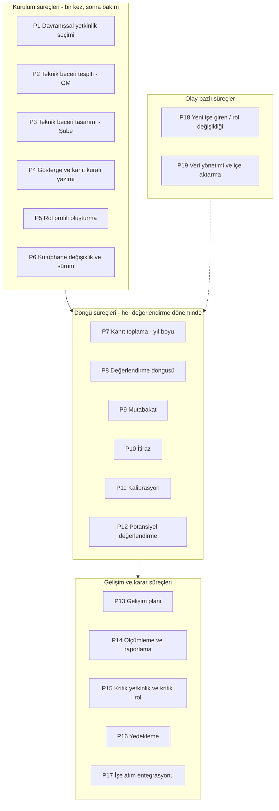
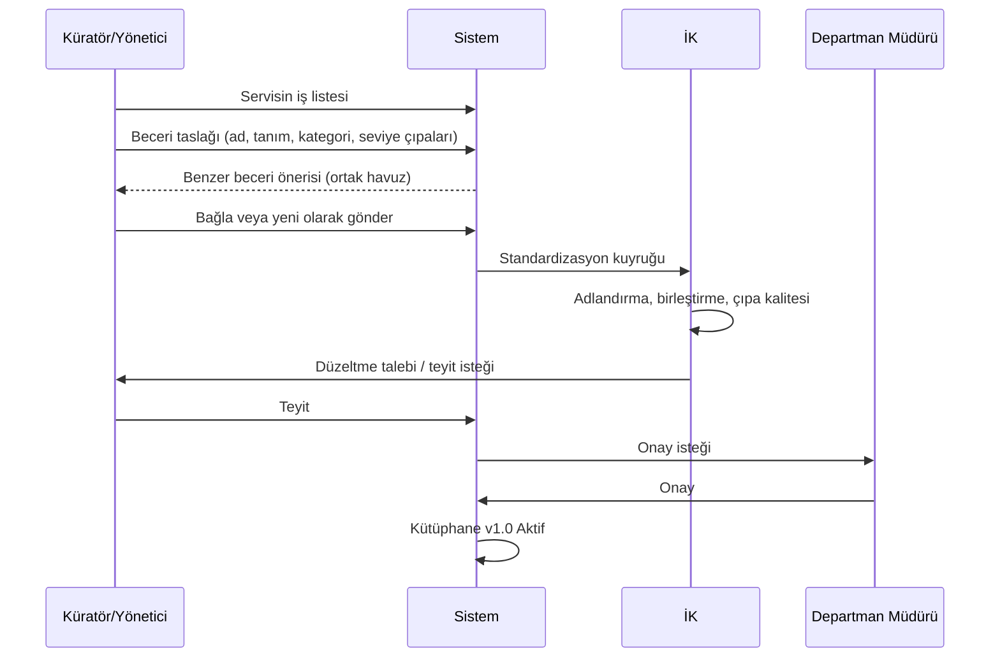
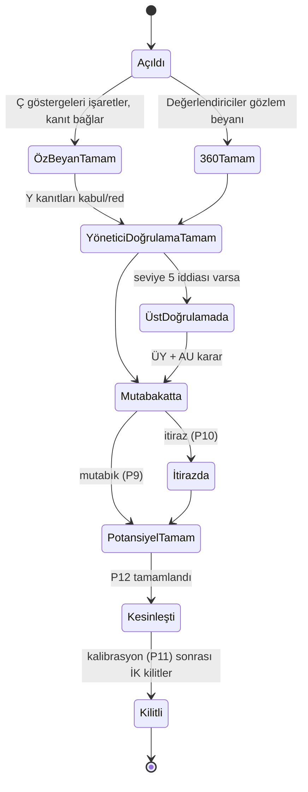

# 09 · Süreç Kitabı — Adım Adım Süreçler

Her süreç aynı şablonla yazıldı: **Amaç · Tetikleyici · Girdi · Adımlar (kim, ne yapar) · Kurallar · Dikkat · Çıktı · Ölçüt.**
Takvim için `08`, veri alanları için `02`, kanıt/gösterge kuralları için `05`, şube ağı uyarlamaları için `06`.

## Süreç haritası

**Roller (kısaltma):** Ç = Çalışan · Y = Yönetici (servis yöneticisi / şube müdürü) · ÜY = Üst yönetici (departman müdürü / bölge müdürü) · İK = İK yetkinlik ekibi · İKİO = Bölge İK iş ortağı · KÜ = Departman küratörü · AU = Alan uzmanı (segment GM) · GMY = Segment / Şube Bankacılığı GMY · YK = Yönlendirme kurulu · S = Sistem (otomatik).

---

## P1 · Davranışsal yetkinlik seçimi

**Amaç:** Kurum için çekirdek ve liderlik davranışsal yetkinlik sözlüğünü belirlemek.
**Tetikleyici:** Proje başlangıcı; sonra yılda bir gözden geçirme.
**Girdi:** 04 aday sözlüğü, kurum değerleri, mevcut 3'lü ölçekli yetkinlik listesi, strateji öncelikleri.

| # | Kim | Adım |
|---|---|---|
| 1 | İK | Aday sözlüğü kurum değerleri ve stratejiyle eşler; her adaya "hangi teknik becerilerin katalizörü?" notu düşer |
| 2 | İK | Mevcut listeyi aday sözlüğe eşler: birebir / birleştirme / emekli; emekli edilenlerin gerekçesi yazılır |
| 3 | İK | 8–12 çekirdek + 5–7 liderlik seçer; her biri için tek cümle tanım |
| 4 | İK | Örtüşme kontrolü: iki yetkinlik %50'den fazla örtüşüyorsa birleştirilir |
| 5 | İK + 5 yönetici | Anlaşılırlık testi: yöneticiler tanımları kendi cümleleriyle anlatır, farklı anlayan varsa yeniden yazılır |
| 6 | YK | Onay; sözlük v1.0 "Aktif" |

**Kurallar:** Çekirdek yetkinlikler tüm rollere, liderlik yetkinlikleri yönetici bayraklı rollere otomatik bağlanır. Sayı üst sınırı 12 + 7.
**Dikkat:** Hiçbir teknik beceriyi beslemeyen yetkinlik şüphelidir. "Tutum" değil "davranış" seçilir (dürüstlük ✗, hesap verebilirlik ✓). Bölgelerin alıştığı yetkinlikler kaldırılıyorsa gerekçe bölgelerle paylaşılır.
**Çıktı:** Davranışsal sözlük v1.0, eşleme tablosu.
**Ölçüt:** Anlaşılırlık testinde 5/5 tutarlı anlatım; her yetkinlik en az 1 katalizör bağına sahip.

---

## P2 · Teknik beceri tespiti — Genel Müdürlük departmanları

**Amaç:** Her servisin işlerinden teknik becerileri çıkarmak ve tek bir standart kütüphanede toplamak.
**Tetikleyici:** Proje başlangıcı; sonra yeni servis kurulması veya yıllık gözden geçirme.
**Girdi:** Servis iş listeleri, görev tanımları, şablon (sablonlar/), ortak beceri havuzu.

| # | Kim | Adım | Dikkat |
|---|---|---|---|
| 1 | İK | Departmana küratör atanmasını ister; küratörü 1 saat eğitir | Küratör işi bilen, yazabilen biri olmalı; müdürün asistanı değil |
| 2 | KÜ + Y | Servisin ana süreçlerini ve tekrarlayan işlerini listeler (5–10 kalem) | İşten başlanır, beceriden değil; aksi halde "Excel bilgisi" gibi genel listeler çıkar |
| 3 | KÜ + Y | Her iş için "bunu yapmak için ne bilmek/yapabilmek gerekir?" sorusuyla beceri çıkarır | Kişilik özellikleri ayıklanır (titizlik ✗) |
| 4 | KÜ | Birleştirme/eleme: çok genel ve çok dar olanlar düzeltilir; servis başına 8–20 beceri | 20'den fazlaysa iş değil görev listesi yazılmıştır |
| 5 | KÜ | Portala girer; sistemin önerdiği benzer beceri varsa bağlar | Mükerrer kayıt haritayı bozar |
| 6 | KÜ + Y | Seviye çıpaları ve göstergeleri yazar (P4 kuralları), hedef seviye önerir, kritiklik, bus factor tahmini, katalizör önerisi | Seviye 4–5 "yönetme/yön verme" içermeli, "daha iyi yapma" değil |
| 7 | İK | Standardizasyon: ad, kategori, birleştirme, çıpa ve gösterge kalite listesi | Kapasite: departman başına ~2 saat |
| 8 | KÜ/Y | İK düzeltmelerini teyit eder | Teyit süresi 5 iş günü; geçerse İK sürümüyle ilerler |
| 9 | ÜY | Departman onayı | Onaysız beceri değerlendirmede açılmaz |
| 10 | S | Beceri "Aktif", sürüm 1.0, servise bağlanır | |

**Kurallar:** Durum akışı Taslak → Gönderildi → İK incelemede → Yönetici teyidi → Müdür onayı → Aktif. Ortak havuzdaki beceri yeni kopyalanmaz, bağlanır.
**Çıktı:** Servis bazlı teknik beceri listesi, göstergeli; ortak havuz.
**Ölçüt:** Mükerrer beceri oranı < %5; servis başına 8–20 beceri; gösterge kalite listesinden geçme ≥ %90.

---

## P3 · Teknik beceri tasarımı — Şube ağı

**Amaç:** Az sayıda şube rolü için tek bir standart beceri seti, hedef matrisi ve otomatik kanıt eşiklerini tasarlamak.
**Tetikleyici:** Proje başlangıcı; sonra ürün/segment değişikliği.
**Girdi:** 06 §3 beş katmanlı set, segment hedef kartları, KPI tanımları, lisans ve yetki kademeleri, geçen yıl KPI dağılımı.

| # | Kim | Adım | Dikkat |
|---|---|---|---|
| 1 | İK | Rol başına çalıştay kurar: segment GM departmanı (2), bölge temsilcisi (2–3), şube müdürü (2–3), İK | Sadece merkez yazarsa saha kabul etmez; sadece saha yazarsa standart olmaz |
| 2 | Çalıştay | Ortak çekirdek (A) ve satış çekirdeği (B) tek seferde, tüm roller için | Aynı beceri her rolde aynı tanım; sadece hedef seviye değişir |
| 3 | Çalıştay | Segmente özgü (C), gişe/operasyon (D), yönetim (E) becerileri | Rol başına toplam 12–18 |
| 4 | Çalıştay | Her beceri × seviye için göstergeler (P4) | |
| 5 | GMY + Delphi paneli | Her otomatik kanıt göstergesi için KPI eşiği: KPI kodu, karşılaştırma, eşik, dönem sayısı; ➕ E2: eşik, 5 kişilik panelin (GMY, 2 bölge müdürü, 2 şube müdürü) anonim iki turlu Delphi puanlamasıyla belirlenir | Geçen yıl verisiyle simülasyon: eşik, kişilerin kaçını hangi seviyeye koyuyor? |
| 6 | İK + Uyum | Lisans ön koşulları ve yetki limiti eşlemeleri | Lisans yoksa seviye kilidi: uyum riski aynı zamanda |
| 7 | GMY | Şube sınıfına göre hedef istisnaları | Kurumsal şube +1 kuralı |
| 8 | İK | Katalizör bağları ve ağırlıkları | |
| 9 | GMY | Seviye 5 alan uzmanlarını atar (segment başına 2–3) | |
| 10 | İK | 2 şubede kuru test: 3 kişinin kanıtı elle hesaplanır, çıkan seviye makul mu? | Makul değilse eşik veya gösterge düzeltilir |
| 11 | GMY | Onay; Aktif | |

**Kurallar:** Şube becerileri merkezi sahiplidir; şubeler ekleme/çıkarma yapamaz, öneri gönderir (P6).
**Çıktı:** Şube teknik kütüphanesi, hedef matrisi, KPI eşik tablosu, lisans/yetki eşlemesi, alan uzmanı listesi.
**Ölçüt:** Simülasyonda seviye dağılımı tek noktada yığılmıyor (hiçbir seviye > %60); kuru testte 3/3 makul sonuç.

---

## P4 · Gösterge ve kanıt kuralı yazımı

**Amaç:** Her yetkinlik × seviye için kanıtlanabilir davranış göstergeleri ve kanıt kabul kuralları.
**Tetikleyici:** P1, P2, P3 içinde; ve her kütüphane değişikliğinde.
**Girdi:** Seviye genel tanımları (01 §2.2), kanıt türleri (05 §3, 06 §4).

| # | Kim | Adım |
|---|---|---|
| 1 | Yazan (KÜ / çalıştay / İK) | Seviye başına 3–5 gösterge: geçmiş zaman, tek davranış, gözlenebilir, kanıtı tarif eden |
| 2 | Yazan | Her seviyede en az 1 **zorunlu** gösterge |
| 3 | Yazan | Her gösterge için kabul edilen kanıt türleri, min kanıt sayısı (1), geçerlilik (24 ay) |
| 4 | Yazan | Sistem verisiyle doğrulanabilen göstergeler için otomatik kural (KPI/lisans/yetki/denetim) |
| 5 | Yazan | Potansiyel boyutuna da sayılacak göstergeleri işaretler (öğrenme çevikliği, stretch, ön-liderlik) |
| 6 | İK | Kalite kontrol listesi (şablon §4): fiil, seviye farkı, tek davranış, kanıt türü |
| 7 | İK | 3 farklı kişiyle "aynı kanıtı aynı göstergeye bağlar mı?" testi |

**Kurallar:** "Yapabilir / bilir" içeren gösterge reddedilir. Seviye N göstergeleri N-1'in tekrarı olamaz; kapsam, özerklik veya etki farkı taşımalı.
**Dikkat:** Göstergeyi kanıtı olmayan bir davranışa yazmak, o seviyeyi kimsenin alamaması demektir. Kanıt bulunamayacaksa gösterge yazılmaz.
**Çıktı:** Gösterge seti, kanıt kuralları, otomatik kural listesi.
**Ölçüt:** 3 kişilik testte eşleme tutarlılığı ≥ %80.

---

## P5 · Rol profili oluşturma

**Amaç:** Her rol için gereken yetkinlikler, hedef seviye, ağırlık ve zorunluluk.
**Tetikleyici:** Kütüphane aktifleşince; yeni rol; rol tanımı değişikliği.
**Girdi:** Aktif kütüphane, rol listesi, kademe yapısı, şube sınıfları.

| # | Kim | Adım | Dikkat |
|---|---|---|---|
| 1 | S | Çekirdek davranışsal → tüm rollere; liderlik → yönetici rollerine otomatik | Elle girilmez |
| 2 | Y + İK | Teknik beceri seçimi ve hedef seviye: "bu rolde beklenen" | "İdeal" değil; her hedefi 4 yapan müdüre itiraz |
| 3 | Y + İK | Rol içi ağırlık (1–3) ve zorunlu işareti | Zorunlu = işe alım/terfi eşiği (S5 gereği ilk döngülerde sadece raporlanır) |
| 4 | Y | Kademe kuralı: üst kademe +1 | |
| 5 | GMY | Şube sınıfı istisnaları (şube rolleri) | |
| 6 | S | Tutarsızlık raporu: aynı rol farklı birimde farklı hedef; satır sayısı > 30 | Gerekçe veya düzeltme |
| 7 | Y + İK | Kariyer yolu: sonraki rol(ler) | Yedekleme ve gelişim planı buradan beslenir |
| 8 | ÜY | Onay; profil v1.0 | |

**Kurallar:** Pozisyon istisnası sadece gerekçeyle ve İK onayıyla. Profil sürümlüdür; döngü açıldıktan sonra o döngü için değişmez.
**Çıktı:** Rol profilleri; "profilsiz pozisyon" listesi sıfır.
**Ölçüt:** Kişi başı satır ≤ 30; tutarsızlık raporu kapatılmış.

---

## P6 · Kütüphane değişiklik ve sürüm yönetimi

**Amaç:** Kütüphaneyi canlı tutmak, geçmiş değerlendirmeleri bozmadan.
**Tetikleyici:** Değişiklik önerisi (yönetici, küratör, İK, kalibrasyon bulgusu, döngü sonu revizyonu).

| # | Kim | Adım |
|---|---|---|
| 1 | Öneren | Portalda öneri: yeni beceri / gösterge düzeltme / emekli etme / eşik değişikliği, gerekçe |
| 2 | İK | Etki analizi: kaç rol profili, kaç açık değerlendirme etkilenir |
| 3 | İK | Küçük düzeltme (yazım, netleştirme) → aynı sürüm; anlam değişikliği → **yeni sürüm** |
| 4 | Sahip (ÜY / GMY) | Onay |
| 5 | S | Yeni sürüm Aktif, eski sürüm Emekli; açık döngüler eski sürümde devam eder, sonraki döngü yeni sürümle açılır |
| 6 | S | Etkilenen rol profillerine bildirim; profil sahibi hedefi gözden geçirir |

**Kurallar:** Döngü ortasında eşik ve gösterge değişmez (biriken revizyonlar döngü sonunda uygulanır). Emekli beceri geçmiş raporlarda görünür, yeni değerlendirmede açılmaz.
**Dikkat:** Her kalibrasyon oturumu değişiklik önerisi üretir; bunlar birikir ve döngü kapanışında topluca ele alınır.
**Çıktı:** Sürüm notu, etki raporu.
**Ölçüt:** Değişiklik önerisi kapanış süresi ≤ 30 gün (döngü dışı).

---

## P7 · Kanıt toplama (yıl boyu)

**Amaç:** Değerlendirme anında değil, iş olurken kanıt biriktirmek; yöneticinin döngü yükünü azaltmak.
**Tetikleyici:** Sürekli; otomatik kanıtlar aylık veri yüklemesiyle; manuel kanıt her zaman.

| # | Kim | Adım | Dikkat |
|---|---|---|---|
| 1 | S | Aylık KPI/lisans/yetki/denetim verisi yüklenir (P19); otomatik kural sağlanan göstergeler için kanıt kaydı üretilir | Kaynak kaydı ve dönem kanıtta saklanır |
| 2 | Ç | İş olduğunda "yaptım" formuyla kanıt ekler (web/mobil): ne yaptım, ne zaman, sonuç, kim doğrular, dosya | Kanıt kasası döngü dışında da açık |
| 3 | Ç | Kanıtı ilgili gösterge(ler)e bağlar; sistem rol profilindeki eksik göstergeleri önerir | Bir kanıt birden çok göstergeyi karşılayabilir |
| 4 | Y | Gözlem notu ekler (ortak müşteri görüşmesi, iş başı gözlem, proje) | Tarihli ve somut; "iyi çalışıyor" kanıt değildir |
| 5 | Y | İsterse kanıtı hemen inceler (Kabul / Ek bilgi / Red); yoksa döngüde toplu inceler | Erken inceleme döngü yükünü dağıtır |
| 6 | S | Kişiye "hedef seviyeye kadar eksik göstergeler" panosu; bayatlayacak kanıtlar için 60 gün önce uyarı | |
| 7 | S | ➕ E3: 360 danışma beyanlarından "gizli uzman" bayrağı → yöneticiye "kanıt eksik olabilir" uyarısı; ➕ E7 (Faz 2): gelişim görevi tamamlanınca otomatik kanıt | |

**Kurallar:** Kanıt geçerliliği 24 ay. Red edilen kanıt gerekçesiyle saklanır. Seviye 5 göstergesine bağlanan kanıt üst doğrulama kuyruğuna düşer.
**Dikkat:** Kanıt "övgü yazısı" değil, çıktıdır. Çalışanlar başta çok sayıda zayıf kanıt yükler; yöneticiye "kanıt kalitesi" kılavuzu verilmeli. Gizli/kişisel veri içeren dosyalar (müşteri bilgisi) maskelenmeli.
**Çıktı:** Kişi başı kanıt kasası; gösterge kapsama oranı.
**Ölçüt:** Döngü açılmadan önce hedef seviye göstergelerinin ≥ %40'ı kanıtlı (otomatik + manuel).

---

## P8 · Değerlendirme döngüsü

**Amaç:** Her çalışanın rol profilindeki her yetkinlik için kanıtlanmış ve mutabık seviyeyi belirlemek.
**Tetikleyici:** İK döngüyü açar (ana: yıllık; ara: 6 ay; işe giriş: 90. gün).
**Girdi:** Aktif kütüphane sürümü, rol profilleri, kanıt kasası, organizasyon verisi.

| Aşama | Kim | Ne yapar | Kurallar | Dikkat |
|---|---|---|---|---|
| 0 Açılış | İK | Kapsam (birimler/dalga), kütüphane sürümü, aşama tarihleri; sistem her kişi için satırları rol profilinden üretir | Satırlar döngü boyunca sabit | Profilsiz pozisyon varsa döngü açılmaz |
| 1 Öz-beyan | Ç | Her satırda göstergeleri işaretler, kanıt bağlar; otomatik kanıtlar hazır gelir; "istek ve kariyer hedefi" alanını doldurur (potansiyel girdisi) | Sadece hedef seviyeye kadar göstergeler zorunlu; üstü isteğe bağlı | Sayı seçmez; sistem öz-beyan seviyesini hesaplar |
| 2 360 | Y seçer, Ç ekler | Davranışsal: tüm göstergeler "gözlemledim/gözlemlemedim/fikrim yok" + örnek; teknik: gözlem teyidi | 3–5 + 1–2 değerlendirici; ast/akran anonim; < 3 yanıt gösterilmez; kişi başı ≤ 8 talep | Form ≤ 10 dk; uzarsa yanıt oranı düşer |
| 3 Yönetici doğrulaması | Y | Toplu ekranda gösterge bazında kanıtları Kabul / Ek bilgi / Red; gözlem notu ekler; sistem kanıtlanmış seviyeyi hesaplar | Red gerekçesi zorunlu; "ek bilgi" 5 iş günü; 360 tek başına kanıt değil | Yönetici "hak ediyor ama kanıt yok" diyorsa seviye vermez, kanıt görevi açar |
| 4 Üst doğrulama | ÜY + AU | Seviye 5 göstergelerini onaylar/reddeder | Onaysız 5 yok; mutabık en fazla 4 | Kuyruk takibi; 1 hafta |
| 5 Mutabakat | Y + Ç | P9 | | |
| 6 İtiraz | İKİO/İK + ÜY | P10 | | |
| 7 Potansiyel | Y + İK | P12 | | |
| 8 Kesinleşme | S | Satırlar kesinleşir; tutarlılık bayrakları hesaplanır | | |
| 9 Kalibrasyon | ÜY + İK | P11; düzeltmeler gerekçeli | | |
| 10 Kilit | İK | Anlık görüntü; sonraki değişiklik "düzeltme kaydı" ile | | |

**Dikkat (genel):** Aşama tamamlanma oranı birim bazında izlenir; < %70 olan birime İK iş ortağı müdahalesi. ➕ E4: yönetici yük panosu; tahmini bekleyen iş 8 saati aşan yöneticiye İK iş ortağı desteği ve "öncelikli satırlar" görünümü. Yönetici cömertlik endeksi aşama 3 bitince hesaplanır ve kalibrasyona taşınır.
**Çıktı:** Kişi × yetkinlik mutabık seviye, kanıt izi, açık, bayraklar.
**Ölçüt:** Tamamlanma ≥ %90; öz-beyan ile kanıtlanmış seviye farkı ortalama ≤ 0,5; itiraz oranı ≤ %10.

---

## P9 · Mutabakat

**Amaç:** Çalışan ve yöneticinin kanıtlanmış seviyeyi birlikte teyit etmesi; farkları kanıt üzerinden çözmek.
**Tetikleyici:** Yönetici doğrulaması (ve varsa üst doğrulama) tamamlanınca.

| # | Kim | Adım |
|---|---|---|
| 1 | S | Her satırda öz-beyan, kanıtlanmış ve önerilen mutabık seviyeyi gösterir; **görüşme zorunlu** satırları işaretler: fark ≥ 2 veya reddedilmiş zorunlu kanıt |
| 2 | Y | Görüşmeyi planlar (2 hafta içinde); görüşme öncesi çalışan tüm red gerekçelerini görür |
| 3 | Y + Ç | Görüşme: sayı değil kanıt konuşulur — "bu gösterge için hangi kanıt eksik, nasıl tamamlanır?"; eksik gösterge gelişim planı taslağına düşer |
| 4 | Y | Mutabık seviyeyi kaydeder (≤ kanıtlanmış), görüşme notunu yazar |
| 5 | Ç | Onaylar veya itiraz eder (5 iş günü); yanıtsız kalırsa "onaysız mutabık" olarak işaretlenir ve kalibrasyona not düşer |
| 6 | S | Her iki onay ile satır "Mutabık" |

**Kurallar:** Mutabık seviye kanıtlanmış seviyeyi aşamaz. Görüşme notu zorunlu alandır.
**Dikkat:** Görüşmeyi "savunma" değil "gelişim" dili taşır; yöneticilere görüşme kılavuzu verilir. Onaysız mutabık oranı yüksek olan yönetici kalibrasyonda incelenir.
**Çıktı:** Mutabık seviyeler, görüşme notları, gelişim planı taslak satırları.
**Ölçüt:** Mutabık kalınan satır ≥ %85; onaysız mutabık ≤ %5.

---

## P10 · İtiraz

**Amaç:** Adil ve izlenebilir bir ikinci bakış.
**Tetikliyici:** Çalışan mutabakatta itiraz eder (satır bazında, gerekçeli).

| # | Kim | Adım |
|---|---|---|
| 1 | Ç | İtiraz gerekçesi + varsa ek kanıt (5 iş günü içinde) |
| 2 | S | İtiraz mercii atar: GM'de İK + departman müdürü; şubede İKİO + bölge müdürü; şube müdürü için İKİO + Şube Bankacılığı GMY |
| 3 | Merci | Kanıtı ve göstergeyi değerlendirir; gerekirse çalışan ve yöneticiyle 15 dk görüşür |
| 4 | Merci | Karar: seviye korunur / değişir; gerekçe hangi kanıtın nasıl değerlendirildiğini açıkça yazar |
| 5 | S | Karar kesin; satır kapanır; itiraz istatistiği kalibrasyona gider |

**Kurallar:** Karar süresi 10 iş günü. Aynı satır için ikinci itiraz yok. Karar da kanıt kuralına tabidir (kanıtsız yükseltme yapılamaz).
**Dikkat:** İtiraz oranı > %10 olan birim bir "yönetici" sorununa işaret edebilir; kalibrasyonda konuşulur, çalışana yansıtılmaz.
**Çıktı:** Karar kaydı.
**Ölçüt:** Süresinde kapanan itiraz ≥ %95.

---

## P11 · Kalibrasyon

**Amaç:** Değerlendiriciler arası tutarlılığı sağlamak; sistem bayraklarını gerekçeli kararlara bağlamak.
**Tetikleyici:** Birimdeki satırlar kesinleşince; kademeli: şube/servis → bölge/departman → merkez.

| Kademe | Katılımcı | Girdi (sistem panosu) | Çıktı |
|---|---|---|---|
| Şube / Servis | Y | Ekip dağılımı, portföyler arası tutarlılık, bayraklar | Yönetici kendi düzeltmelerini yapar (gerekçeli) |
| Bölge / Departman | ÜY + İKİO (+ AU gerektiğinde) | Birimler arası dağılım, yönetici cömertlik endeksi, KPI–seviye uyumsuzluğu, devralınan seviyeden sapma, onaysız mutabık, itiraz oranı, tutarlılık bayrağı (teknik yüksek–katalizör düşük) | Düzeltme kararları (satır bazında, gerekçeli); eşik/gösterge revizyon önerileri (P6) |
| Merkez | GMY + İK | Bölgeler/departmanlar arası dağılım, İK iş ortakları arası tutarlılık | Kurum kuralları, eşik revizyon kararları |

**Adımlar (bölge kademesi örneği):**
1. S: oturum öncesi pano ve bayraklı kayıt listesi.
2. İKİO: oturumu yönetir; her bayrağı sırayla açar.
3. ÜY + Y'ler: bayraklı kayıt için kanıt incelenir; karar: koru / düşür / kanıt görevi aç.
4. S: karar ve gerekçe satıra işlenir; çalışan bilgilendirilir (seviye düştüyse yönetici görüşme yapar).
5. İKİO: oturum notu, revizyon önerileri.

**Kurallar:** Kalibrasyon seviye **yükseltemez** (kanıt kuralı); sadece düşürür veya kanıt görevi açar. Zorunlu dağılım (rank-and-yank) yoktur; dağılım sadece sinyaldir.
**Dikkat:** Kalibrasyon "cezalandırma toplantısı" algılanırsa yöneticiler bir sonraki döngüde herkesi düşük verir. Odak, yönetici tutarlılığı ve gösterge kalitesidir.
**Çıktı:** Düzeltme kayıtları, revizyon önerileri, oturum notu.
**Ölçüt:** Yönetici cömertlik endeksi |x| ≤ 0,5 olan yönetici oranı ≥ %80; bayraklı kayıtların %100'ü karara bağlanmış.

---

## P12 · Potansiyel değerlendirme

**Amaç:** Uzmanlık ve liderlik potansiyelini kanıtla ölçmek; yedekleme ve gelişim yatırımına girdi.
**Tetikleyici:** Ana döngüde mutabakat tamamlanınca (yılda bir).

| # | Kim | Adım |
|---|---|---|
| 1 | S | Hesaplanan boyutlar: öğrenme çevikliği (ilgili davranışsal seviyeler), katalizör profili, (2. döngüden) gelişim hızı |
| 2 | Ç | İstek ve hareketlilik beyanı (kariyer hedefi rolü, rotasyona/lokasyona açıklık) — öz-beyanda doldurulmuştu |
| 3 | Y | Potansiyel göstergeleri (stretch, ön-liderlik, öğrenme çevikliği) için kanıt kabul/red — aynı kanıt kasası |
| 4 | S | Uzmanlık ve liderlik potansiyeli (1–5) + güven düzeyi |
| 5 | Y | Teyit veya gerekçeli düzeltme (sadece aşağı; yukarı için kanıt) |
| 6 | İK | Kalibrasyonda (P11) potansiyel dağılımı birimler arası karşılaştırılır |

**Kurallar:** Çalışana puan "etiket" olarak gösterilmez; gelişim önerisi olarak gösterilir. Ücret/terfiyle bağ yok.
**Dikkat:** Yöneticiler "en sevdiğim" ile "potansiyel"i karıştırır; kanıt zorunluluğu bunu sınırlar. Düşük güven düzeyi (az kanıt) olan puan karar için kullanılmaz.
**Çıktı:** Kişi bazlı potansiyel kaydı.
**Ölçüt:** Güven düzeyi Orta+ olan kayıt oranı ≥ %70.

---

## P13 · Gelişim planı

**Amaç:** Açığı eyleme çevirmek; eksik gösterge = yapılacak iş.
**Tetikleyici:** Döngü kilitlenince (ana); ara döngüde güncelleme.

| # | Kim | Adım | Dikkat |
|---|---|---|---|
| 1 | S | Açık ve öncelik puanı (açık × ağırlık × kritiklik); kanıtlanmamış göstergeler listelenir; katalizör düşükse önce katalizör önerisi | İlk 3–5 öncelik; dağılma yok |
| 2 | Ç | Taslak plan: her öncelik için eylem (iş başında / mentor / eğitim), bitiş, başarı kanıtı | Eylem "eğitime git" değil "X göstergesini kanıtlayacak iş" |
| 3 | S | Mentor önerisi: aynı beceride seviye ≥ 4, mentor başına ≤ 3 menti; ➕ E3: danışılma sayısı yüksek kişiler aday listesine eklenir; ➕ E1: kariyer hedefi için "en yakın 3 rol" ve geçiş açığı gösterilir; ➕ E7 (Faz 2): açık uyan gelişim görevleri önerilir | |
| 4 | Y | Planı onaylar, kaynak taahhüdü (görev, rotasyon, proje) | Yönetici "iş" vermezse plan kâğıtta kalır |
| 5 | Ç + Mentor | Uygulama; ilerleme % ve notlar | Çeyrekte bir kontrol |
| 6 | Ç | Eylem tamamlanınca kanıtı kasaya ekler → gösterge → ara döngüde yeniden değerlendirme | Kapanış = seviye artışı veya gösterge kanıtı |
| 7 | S | Plan tamamlama ve gelişim hızı metrikleri | |

**Kurallar:** Plan satırı bir göstergeye bağlı olmak zorunda. Kariyer hedefi (sonraki rol) seçildiyse o rolün profili de açık hesabına girer.
**Çıktı:** Bireysel gelişim planı; mentor eşleşmeleri.
**Ölçüt:** Plan oranı ≥ %80; tamamlama ≥ %60; yılda kişi başı ≥ 1 seviye adımı (hedef beceride).

---

## P14 · Ölçümleme ve raporlama

**Amaç:** Kurumun yetkinlik haritasını, güçlü ve gelişim alanlarını, trendi görünür kılmak.
**Tetikleyici:** Döngü kilidi (anlık görüntü); sürekli panolar.

| # | Kim | Adım |
|---|---|---|
| 1 | S | Döngü kilidinde anlık görüntü: kişi × yetkinlik × seviye; metrikler (01 §4.6) |
| 2 | İK | Kurum, GM, bölge, şube sınıfı, segment ısı haritaları; güçlü alanlar (≥ hedef+0,5), gelişim alanları (< %60 karşılama) |
| 3 | İK | Kalite metrikleri: öz–kanıtlanmış farkı, cömertlik, itiraz, 360 yanıt, plan oranı |
| 4 | İK | Devralınan vs kanıtlanmış karşılaştırması (ilk döngü), trend (sonraki döngüler) |
| 5 | İK | Katalizör ve potansiyel doğrulama (n ≥ 30; 2. döngüden); ➕ E10: ölçüm kalitesi panosu (kappa, gösterge ayırt ediciliği, KPI–seviye yakınsama) |
| 5b | İK + GMY | ➕ E6 (Faz 2): stratejik beceri planı — yükselen becerilerde kapsama hedefi, azalan becerilerde yatırım durdurma; gelecek eğilimi etiketleri yıllık gözden geçirilir |
| 6 | İK → YK/GMY | Döngü raporu: bulgular, revizyon önerileri, yatırım öncelikleri |
| 7 | Y/ÜY | Kendi birim panosu; envanter araması ("X ≥ 3 kimde var") |

**Kurallar:** Kişi bazlı veri yalnızca hiyerarşi hattı + İK; diğerleri toplulaştırılmış. Envanter aramasında puan detayı değil "≥ eşik" görünür.
**Dikkat:** Birimler arası sıralama yayımlamayın; "gelişim alanı" dili. Harita önce yöneticilerle, sonra çalışanlarla.
**Çıktı:** Isı haritaları, metrik panoları, döngü raporu.
**Ölçüt:** Rapor döngü kilidinden ≤ 4 hafta sonra; yönetici pano kullanım oranı.

---

## P15 · Kritik yetkinlik ve kritik rol belirleme

**Amaç:** Kaybı kurumu zorlayacak beceri ve rolleri nesnel kriterle işaretlemek.
**Tetikleyici:** Döngü kilidinden sonra yılda bir; büyük organizasyon değişikliğinde.

| # | Kim | Adım |
|---|---|---|
| 1 | S | Her beceri için iç kıtlık (bus factor) ve kayıp riski (sahiplerin ayrılma/emeklilik riski) hesaplanır |
| 2 | ÜY/GMY + İK | İş etkisi, edinim süresi, dış kıtlık puanlanır (1–5); ➕ E2: Delphi aracıyla anonim iki tur |
| 3 | S | Kritik beceri skoru (02 §3 formülü) ≥ eşik → "Kritik" önerisi |
| 4 | ÜY/GMY + İK | Öneriyi onaylar/düzeltir (gerekçeli) |
| 5 | ÜY/GMY + İK | Kritik rol: stratejik etki, benzersizlik, doldurma süresi, boşluk maliyeti, kritik beceri yoğunluğu → skor → onay |
| 6 | Y | Her kritik beceri için **bilgi aktarım planı** (dokümantasyon / gölgeleme / çift kadro), sahip ve alıcı |
| 7 | S | Kritik beceri/rol listesi yedeklemeye (P16) ve işe alıma (P17) akar |

**Kurallar:** Kritik rol sayısı toplam rollerin ~%10–15'i; aşıyorsa kriter sıkılaştırılır. Tek sahipli kritik beceri (bus factor 1) için aktarım planı zorunlu.
**Dikkat:** Her müdür kendi rollerini kritik görür; skor nesnel olmalı, onay bir üst kademede.
**Çıktı:** Kritik beceri ve rol listesi; bilgi aktarım planları; risk kaydı.
**Ölçüt:** Bus factor 1 olan kritik beceri sayısı yıl içinde azalıyor; aktarım planı tamamlama.

---

## P16 · Yedekleme (succession)

**Amaç:** Her kritik rol için hazırlık seviyesi belli aday havuzu.
**Tetikleyici:** P15 sonrası yılda bir; kritik rol boşalma riski sinyalinde.

| # | Kim | Adım |
|---|---|---|
| 1 | S | Her kritik rol için aday önerisi: kariyer yolunda olan + rol profiline göre açık + potansiyel + ➕ E1 beceri komşuluğu (kariyer yolunda tanımlı olmayan ama profili yakın kişiler de önerilir); hazırlık önerisi (Hazır / 1–2 yıl / 3+) |
| 1b | İK | ➕ E9 (Faz 2): şube/bölge müdürü havuzundaki "1–2 yıl" adayları için değerlendirme merkezi; sonuç "Simülasyon" kanıtı olarak kasaya girer |
| 2 | ÜY + İK | Aday havuzunu teyit eder, ekler/çıkarır (gerekçeli); hazırlığı onaylar |
| 3 | S | Her aday için otomatik gelişim planı taslağı (hedef rol açıkları) → P13 |
| 4 | İK | Yedek derinliği raporu: kritik rol başına 0 / 1 / 2+ hazır yedek; şube müdürlüğü ve bölge müdürlüğü havuzları bölge bazında |
| 5 | İK | Sahip risk kaydı (ayrılma, emeklilik) ile birleşik risk panosu; yedeksiz + yüksek riskli rol listesi → YK |
| 6 | ÜY | Yedeksiz kritik rol için karar: içeriden yetiştir (plan) / dışarıdan al (P17) / rol tasarımını değiştir |

**Kurallar:** Hazırlık "Hazır" için zorunlu becerilerde açık sıfır. Aday listesi çalışana "yedek" etiketiyle açıklanmaz; gelişim planı olarak yansır.
**Dikkat:** Tek aday tek rol değil; bir kişi en fazla 2 kritik role aday. Hazırlık değerlendirmesi yılda bir güncellenmezse liste bayatlar.
**Çıktı:** Yedek havuzları, derinlik raporu, risk kararları.
**Ölçüt:** Kritik rollerin ≥ %80'inde en az 1 "1–2 yıl" veya "Hazır" aday; yedeksiz kritik rol sayısı düşüyor.

---

## P17 · İşe alım entegrasyonu

**Amaç:** Açığı dışarıdan kapatırken aynı yetkinlik dilini kullanmak.
**Tetikleyici:** Yedeksiz kritik rol/beceri (build/buy kararı "buy"); pozisyon boşalması; yeni kadro.

| # | Kim | Adım |
|---|---|---|
| 1 | S | Build/buy önerisi: kritik beceride içeride "1–2 yıl" adayı yoksa işe alım talebi önerir |
| 2 | Y + İK İşe Alım | Talep: rol profilinden zorunlu/önemli beceriler ve hedef seviyeler otomatik iş tanımına |
| 3 | S | Mülakat kılavuzu: her beceri için hedef seviyenin göstergelerine dayalı davranışsal sorular (STAR), puan kartı aynı 1–5 ölçek |
| 4 | Mülakatçılar | Her beceri için seviye ve gerekçe; aday açık raporu |
| 5 | Y + İK | Karar; zorunlu beceri eşiği altı için gerekçe |
| 6 | S | İşe alınınca kişi profili açılır, mülakat puanları "aday dönemi" kaydı; 90. gün değerlendirmesi planlanır (P18); ilk gelişim planı taslağı |
| 7 | İK | İşe alım kalitesi: mülakat seviyesi ile 90. gün / 1. yıl kanıtlanmış seviye karşılaştırması |

**Dikkat:** Mülakatta "yaptım" ilkesi aynen: aday geçmiş örnek verir, "yapabilirim" puan almaz.
**Çıktı:** İş tanımı, kılavuz, aday raporu, işe alım kalitesi metriği.
**Ölçüt:** Mülakat–90. gün sapması ortalama ≤ 1 seviye.

---

## P18 · Yeni işe giren / rol değişikliği / ayrılma

**Tetikleyici:** Atama değişikliği (içe aktarma veya elle).

| Olay | Adımlar |
|---|---|
| Yeni işe giren | Pozisyon → rol profili bağlanır; kanıt kasası açılır; 90. gün işe giriş döngüsü planlanır (yalnızca zorunlu beceriler + çekirdek davranışsal); mülakat puanları referans olarak görünür; ilk plan taslağı |
| Rol/pozisyon değişikliği | Eski profil kayıtları korunur; yeni profile göre açık hesaplanır; mevcut kanıtlar yeni göstergelere yeniden bağlanabilir; yöneticiye "geçiş açığı" bildirimi; bir sonraki döngüde yeni profille değerlendirilir |
| Yönetici değişikliği | Açık döngüde yeni yönetici doğrulamayı devralır; eski yöneticinin gözlem notları kalır |
| Ayrılma | Kritik beceri sahibi ise bilgi aktarım planı tetiklenir; yedek havuzu güncellenir; kayıtlar saklama süresine kadar arşiv |

**Dikkat:** Atama verisi aylık güncellenmezse yöneticiler yanlış kişileri değerlendirir; P19 kalitesi buraya bağlı.

---

## P19 · Veri yönetimi ve içe aktarma

**Amaç:** Organizasyon, kişi, KPI, lisans, yetki ve devralınan verinin doğru ve zamanında sisteme girmesi.
**Tetikleyici:** Aylık (organizasyon, kişi, KPI, lisans, yetki); bir kez (devralınan).

| # | Kim | Adım |
|---|---|---|
| 1 | İK / BT | HRIS ve satış/kredi/uyum sistemlerinden CSV dışa aktarma (07 §4 şemaları) |
| 2 | S | Doğrulama raporu: eşleşmeyen kod, eksik üst birim, mükerrer sicil, tanımsız KPI, tarih formatı |
| 3 | İK | Hataları kaynakta düzeltir; **hatalı satır işlenmez**, temiz satırlar işlenir |
| 4 | S | Organizasyon/atama değişikliklerini uygular; P18 olaylarını tetikler |
| 5 | S | KPI/lisans/yetki → otomatik kanıt kuralları (P7) |
| 6 | İK | Aylık veri kalite özeti: hata oranı, gecikme |

**Kurallar:** Döngü açıkken organizasyon değişikliği sadece atama düzeyinde uygulanır; birim ağacı değişikliği döngü sonuna bırakılır. KVKK: veri envanteri, saklama 5 yıl, erişim logu.
**Dikkat:** En sık hatalar: yönetici sicili eşleşmiyor, şube sınıfı boş, KPI dönem tanımı tutarsız. İlk yüklemede sıfır hata beklenmez; 2–3 tur ayrılmalı.
**Çıktı:** Temiz veri, doğrulama raporu, kalite özeti.
**Ölçüt:** Hata oranı < %1; yükleme gecikmesi ≤ 5 iş günü.

---

## Süreçler arası kontrol noktaları (özet)

| Kontrol | Nerede | Kural |
|---|---|---|
| Kanıt kuralı | P7, P8, P9, P10, P11, P12 | Kanıtsız seviye yok; mutabık ≤ kanıtlanmış; kalibrasyon yükseltemez |
| Seviye 5 | P8 | ÜY + AU onayı |
| Sürüm | P6, P8 | Döngü açıldığı sürümde kapanır |
| Satır sınırı | P5 | Kişi başı ≤ 30 |
| Gizlilik | P8 (360), P14, P16 | Anonimlik, toplulaştırma, etiket yok |
| Ayrıklık | P12, P13, P16 | Ücret/terfi bağlantısı yok (S5) |
| Denetim izi | Tümü | Kim, ne, ne zaman, önce/sonra |
